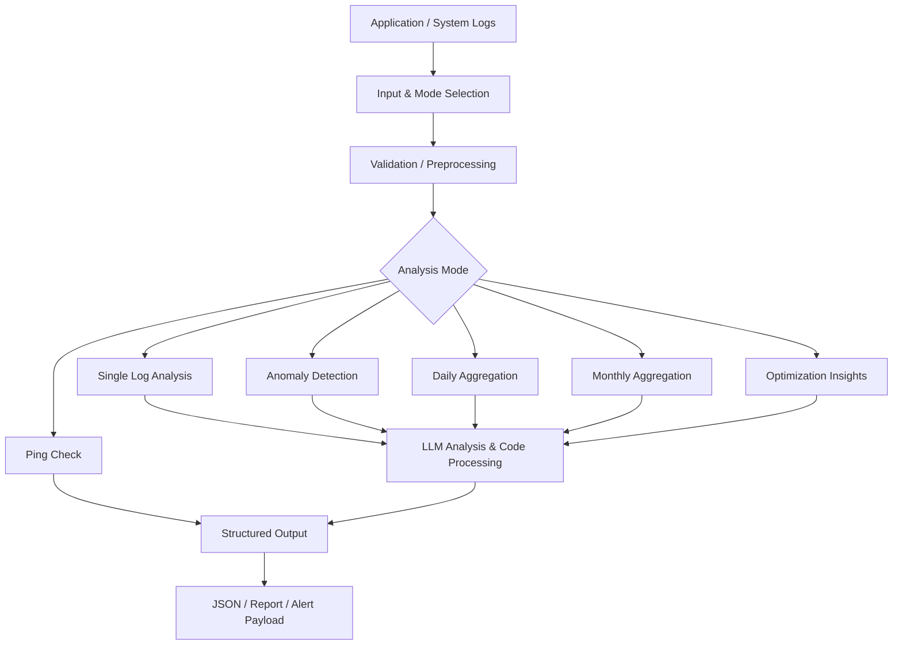

# LogAnalyzer | AI-Powered Log Intelligence

**AI 기반 로그 분석 · 이상 징후 탐지 · 운영 리포트 자동화**

> 다양한 시스템 로그를 정규화·집계하고, 규칙 기반 지표와 LLM 분석을 결합해 운영자가 장애 징후와 개선 포인트를 빠르게 파악하도록 지원하는 프로젝트입니다.

## Overview

LogAnalyzer는 단건 로그 분석부터 실시간 이상 징후 판단, 일간·월간 운영 리포트 및 최적화 인사이트 생성까지 하나의 분석 흐름으로 통합하는 로그 운영 자동화 프로젝트입니다.

핵심 설계는 **코드 기반 전처리·집계 → 조건 분기 및 상태 비교 → LLM 해석 → 구조화된 결과 출력**입니다. LLM에 모든 원본 로그를 무조건 전달하는 대신, 먼저 분석에 필요한 정보를 추출·집계하는 구조를 지향합니다.

## Key Features

| 기능 | 설명 |
| --- | --- |
| 단건 로그 분석 | 오류·경고·예외 등 주요 로그 내용 분석 |
| 이상 징후 감지 | 이전 집계값과 현재 지표를 비교하고 이상 여부 분기 |
| 일간 운영 분석 | 시간 단위 분석 결과를 취합해 일간 인사이트 생성 |
| 월간 운영 보고 | 월간 데이터 검증·취합 및 LLM 기반 보고서 생성 |
| 운영 최적화 | 일간·월간 최적화 인사이트 생성 |
| 구조화된 응답 | 코드 노드를 통해 분석 결과를 JSON 형태로 정리 |
| 입력 검증 | 입력 길이 초과, 데이터 누락, 잘못된 모드에 대한 예외 처리 |
| 생존 확인 | `ping` 모드 기반 상태 확인 분기 |

## Architecture

*이 다이어그램은 워크플로우의 주요 기능을 개념적으로 요약한 것으로, 실제 노드 연결을 1:1로 나타낸 것은 아닙니다.*

## Dify Workflows

| 파일 | 목적 |
| --- | --- |
| `logSuite_integrated_20261004.yml` | 통합 로그 분석 워크플로우 (단건·이상감지·일간·월간·최적화·Ping) |
| `logSuite_integrated_20261004_Qwen_offline.yml` | 폐쇄망·Qwen 환경 적용을 고려한 통합 워크플로우 변형 |
| `Log Field Extractor.yml` | 로그 구조 분기 추출, 클러스터 명명, 검증 및 Java 코드/포맷 표기 생성 |

### Log Field Extractor

로그 구조를 분석하고 유형별 패턴을 도출하기 위한 보조 워크플로우입니다.

`구조 분기 추출 → LLM 클러스터 명명 → 병합·검증·리포트 → Java 코드/포맷 표기 생성`

## Design Highlights

- **Hybrid Analysis**: 규칙·집계 코드와 LLM 해석을 분리해 결과의 일관성과 설명력을 함께 고려
- **Multi-mode Workflow**: 하나의 진입점에서 분석 목적에 따라 서로 다른 처리 흐름 실행
- **Operational Reporting**: 실시간 탐지 결과를 일간·월간 운영 관점으로 확장
- **Defensive Processing**: 입력 검증, 빈 데이터 분기, 오류 응답 처리를 워크플로우에 포함
- **Environment Adaptation**: 외부 모델 환경과 내부망 모델 환경을 위한 별도 DSL 구성

## Getting Started

1. 사용 중인 Dify 환경에서 **Studio → 앱 가져오기**를 선택합니다.
2. 목적에 맞는 `.yml` 파일을 선택합니다.
3. LLM 노드의 모델 및 자격 증명을 해당 환경에 맞게 설정합니다.
4. 시작 노드의 필수 입력값을 확인한 뒤 테스트 실행합니다.
5. 결과 JSON 및 분기별 오류 처리를 검증합니다.

> **호환성 안내:** Dify 버전, 설치된 모델 제공자, 플러그인 및 노드 지원 여부에 따라 DSL 수정이 필요할 수 있습니다. 특히 내부망 환경에서는 모델 매핑과 의존성을 별도로 확인해야 합니다.

## Roadmap

- [ ] 실제 운영 환경별 로그 형식 및 필드 추출 검증 확대
- [ ] 분석 모드별 테스트 케이스와 예제 입출력 문서화
- [ ] 일간·월간 리포트 품질 및 일관성 검증
- [ ] 내부망 Dify 버전별 호환성 검증
- [ ] 민감정보 마스킹 및 배포 보안 점검

## Security Notes

실제 운영 로그에는 계정 정보, 토큰, 내부 주소 등 민감정보가 포함될 수 있습니다. 공개 저장소에는 **실제 API 키, 인증서, 비밀번호, 개인정보 및 내부 운영 로그를 커밋하지 마세요.** 예제 데이터는 비식별화한 샘플을 사용하세요.

---

**LogAnalyzer — From raw logs to actionable operational insights.**
